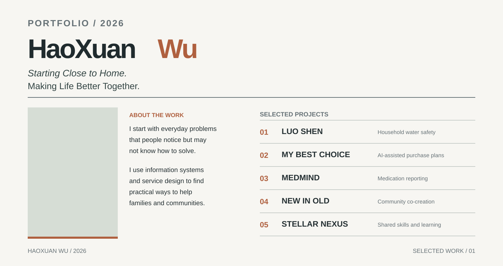
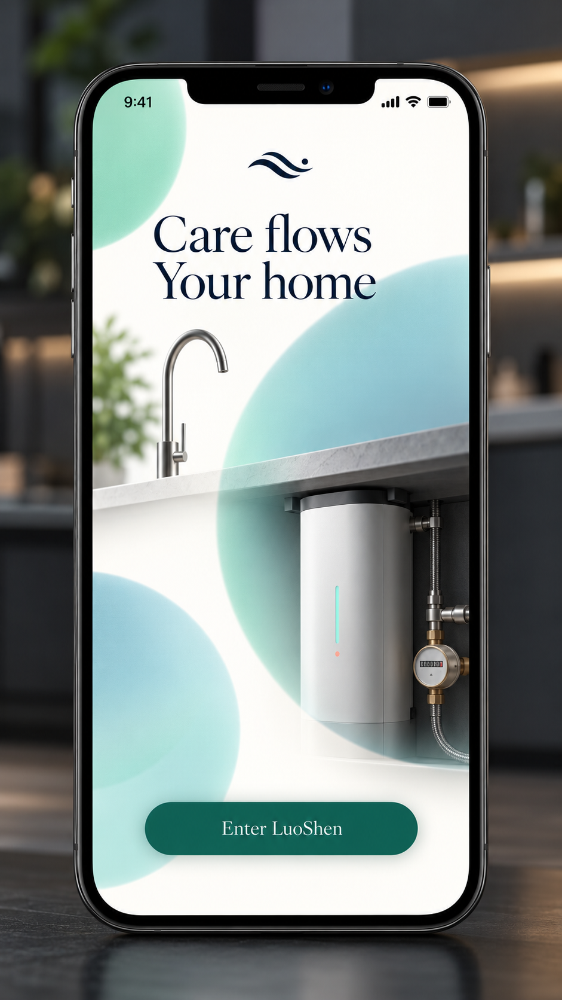
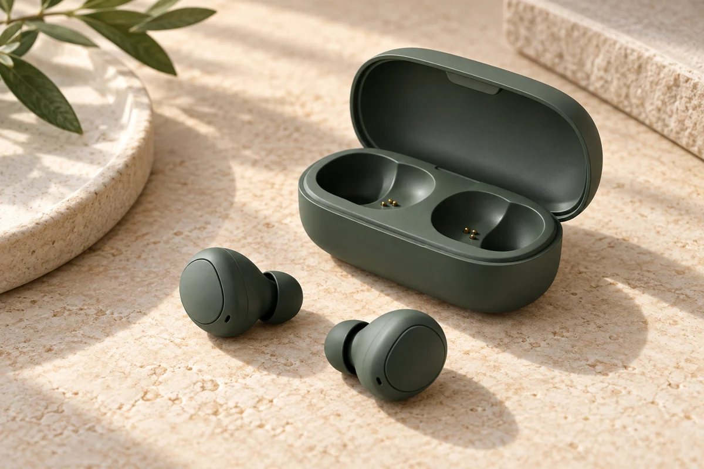
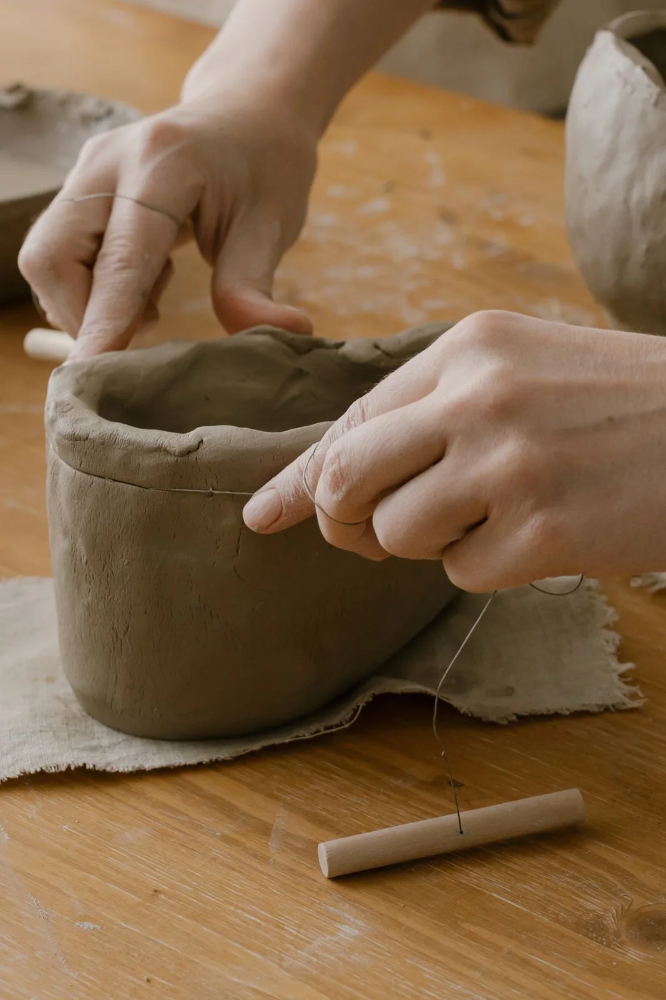
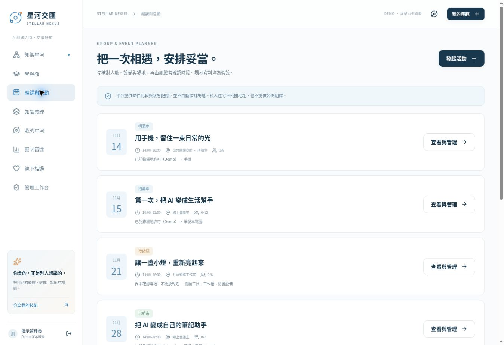

# HaoXuan Wu — Portfolio 2026

*Starting Close to Home. Making Life Better Together.*

I start with everyday problems that people notice but may not know how to solve. Through information systems and service design, I look for practical changes that can help people, families and the communities they live in.

## Selected projects

<table><tr><td width="18%" align="center"></td><td valign="middle"><b>01 — LUO SHEN</b>
A home water-monitoring system for sensitive skin and people at risk from unsafe water temperatures.
<a href="https://github.com/BestTyrion/portfolio-2026/tree/main/1%20LUOSHEN">View project files</a></td></tr>
<tr><td width="18%" align="center"></td><td valign="middle"><b>02 — MY BEST CHOICE</b>
Four psychology-informed AI agents support long-term shopping plans and ongoing price tracking.
<a href="https://github.com/BestTyrion/portfolio-2026/tree/main/2%20My%20Best%20Choice">View project files</a></td></tr>
<tr><td width="18%" align="center"></td><td valign="middle"><b>03 — MEDMIND</b>
A patient-and-doctor reporting system for missed doses and decisions to skip medication.
<a href="https://github.com/BestTyrion/portfolio-2026/tree/main/3%20MEDMIND">View project files</a></td></tr>
<tr><td width="18%" align="center"></td><td valign="middle"><b>04 — NEW IN OLD</b>
A platform where newcomers and older residents create activities, shared memories and local culture together.
<a href="https://github.com/BestTyrion/portfolio-2026/tree/main/4%20NEW%20IN%20OLD">View project files</a></td></tr>
<tr><td width="18%" align="center"></td><td valign="middle"><b>05 — STELLAR NEXUS</b>
A nonprofit platform for self-organised skill learning, with AI support for adjusting group study plans.
<a href="https://github.com/BestTyrion/portfolio-2026/tree/main/5%20Stellar%20Nexus">View project files</a></td></tr></table>

---

Portfolio 2026 · HaoXuan Wu · Five independent projects
